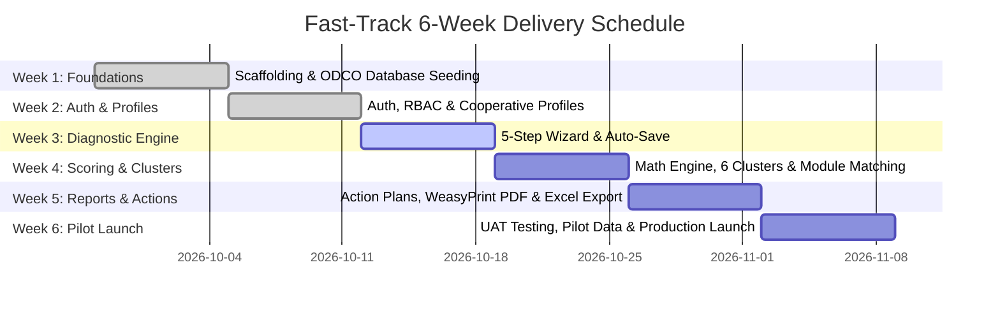

# TTSFR Platform: Fast-Track 6-Week Execution Plan

> **Client:** UM6P | Green Tech Institute (GTI) | Fondation OCP  
> **Project:** TTSFR – Un Modèle Évolutif pour la Transformation Durable des Coopératives  
> **Target:** Fully Functional Platform Deployed in **6 Weeks**  
> **Lead Developer:** Issam ZITOUNI (*Architecte en Technologies du Numérique*)  
> **Stack:** Next.js 14 (TypeScript / Tailwind) + FastAPI (Python) + PostgreSQL 16 (Docker)

---

## 1. Why a 6-Week Plan?

Delivering the working platform in **6 weeks** gives you an immense strategic advantage:
1. **Zero Stress by Month 3:** The core software is built, integrated, and deployed by Week 6.
2. **Real Field Testing:** The 2 pilot cooperatives and the TTSFR team get the remaining 6 weeks to test with real data, practice using the diagnostic, and request minor adjustments without any delivery panic.
3. **Huge Impression on UM6P:** Delivering a functional MVP in half the contractual time proves high engineering velocity and justifies your *prestation d'ingénieur* status.

---

## 2. Week-by-Week Execution Breakdown

### Week 1: Core Scaffolding, Database & Public Showcase
* **Focus:** Environment, Data Architecture & UI Brand System.
* **Key Tasks:**
  * Initialize Monorepo: `frontend/` (Next.js 14 App Router, Tailwind, TypeScript) + `backend/` (FastAPI) + `docker-compose.yml` (PostgreSQL 16).
  * Build Database Schemas & Migrations (SQLAlchemy / Alembic):
    * Users & Roles (`ADMIN`, `COORDINATOR`, `EXPERT`, `COOPERATIVE`).
    * ODCO Sectors & Sub-sectors (seeded with the 12 sectors from Slide 58).
    * The 6 Cluster archetypes (*Artisanal traditionnel*, *Transformation légère*, etc.).
  * Public Landing Page (Responsive, featuring Approach, Partners, Success Stories, and Contact).
* **End of Week 1 Milestone:** Working Docker dev environment + public landing page live.

---

### Week 2: Authentication, Security & Cooperative Spaces
* **Focus:** Multi-Tenancy, Profiles & Access Control.
* **Key Tasks:**
  * JWT Authentication on FastAPI (`/api/v1/auth/login`, `/me`, password reset).
  * Strict Data Isolation Middleware (Ensuring Cooperative A cannot see Cooperative B).
  * Cooperative Profile Module:
    * Identity, location, ODCO sector/sub-sector selection.
    * Member count, equipment list, activity description.
  * Base Cooperative Dashboard shell (*"Espace d'accompagnement"* with the 6 action domain cards).
* **End of Week 2 Milestone:** Authenticated cooperative login + profile setup working on mobile and desktop.

---

### Week 3: The 5-Step Diagnostic Engine & Auto-Save
* **Focus:** The Core Questionnaire Workflow.
* **Key Tasks:**
  * Step Wizard Component (`Étape 1/5` to `Étape 5/5`) with progress indicators.
  * Step 1 Branching: Dynamic sub-sector questions based on chosen sector.
  * Steps 2–5 Questions:
    * Step 2: Operational Performance (processes, quality, safety, waste).
    * Step 3: Economic Performance (sales, cash flow, margins).
    * Step 4: Organizational Maturity (governance, roles, tracking).
    * Step 5: Technological & Energy Maturity (machines, digital, solar/energy).
  * Resilient Auto-Save: LocalStorage sync + Debounced API call (`POST /api/v1/diagnostic/draft`).
* **End of Week 3 Milestone:** Complete 5-step diagnostic fully fillable on a smartphone with auto-save.

---

### Week 4: Scoring Engine, The 6 Clusters & Module Recommendation
* **Focus:** Automation of Business Logic & Taxonomy.
* **Key Tasks:**
  * Python Scoring Engine:
    * Deterministic calculation of dimension scores (0–100%) and global maturity.
    * Matrix logic mapping scores and answers to one of the **6 Clusters**.
    * Rule versioning saved with each submission for audit compliance.
  * Module Matching Service:
    * Tagging training resources into the 4 families (Maturity level, Tech, Sector-specific, Transversal).
    * Automatically filtering relevant modules for the cooperative’s cluster.
* **End of Week 4 Milestone:** Instant cluster assignment and tailored module recommendations upon submitting the survey.

---

### Week 5: Action Plan Tracker, PDF Audit Report & Excel Export
* **Focus:** Outputs, Analytics & Deliverables.
* **Key Tasks:**
  * Cooperative Action Plan Tracker:
    * Action items checklist (Objective, task, assignee, deadline, status: TODO/IN_PROGRESS/DONE).
    * File upload for proof/justification.
    * Internal notes for TTSFR experts.
  * Automated PDF Diagnostic Report (**WeasyPrint**):
    * Institutional UM6P / GTI / Fondation OCP branded header.
    * Summary scores, visual radar chart, assigned cluster badge, and prioritized action plan.
  * TTSFR Admin Dashboard:
    * Overview of both pilot cooperatives.
    * One-click Excel (`.xlsx`) export of all diagnostic responses and synthetic data.
* **End of Week 5 Milestone:** Automated PDF generation, action plan management, and admin data export fully working.

---

### Week 6: UAT, Pilot Cooperative Trials & Production Deployment
* **Focus:** Quality Assurance, Real Pilot Data & Launch.
* **Key Tasks:**
  * Load real data and profiles for the **2 pilot cooperatives**.
  * Mobile responsiveness review (testing on low-bandwidth / 3G mobile connections).
  * Security check: SQL injection, CORS policy, input sanitization, and audit logs.
  * Production Deployment on Target Server (Docker Compose / Nginx / SSL HTTPS certificate).
  * User Acceptance Testing (UAT / *Recette*) session with Dr. Sabah Belil.
* **End of Week 6 Milestone:** **Platform live in production, fully tested and accepted.**

---

## 3. Weekly Deliverables Summary

| Week | Target Deliverable | Demo Focus for Dr. Belil |
| :--- | :--- | :--- |
| **W1** | Architecture + Public Landing Page + ODCO Database | Showcase landing page & visual design system |
| **W2** | Auth + Cooperative Profile + Secure Spaces | Showcase cooperative login & profile on mobile |
| **W3** | 5-Step Diagnostic Wizard with Auto-Save | Live test of completing the survey on phone |
| **W4** | Scoring Engine + 6 Clusters + Module Assignment | Demonstration of automated scoring & clustering |
| **W5** | PDF Audit Report + Action Plan + Excel Export | Downloadable PDF report & admin data export |
| **W6** | Production Deployment & Pilot Sign-Off | Official acceptance sign-off (*Recette*) |
